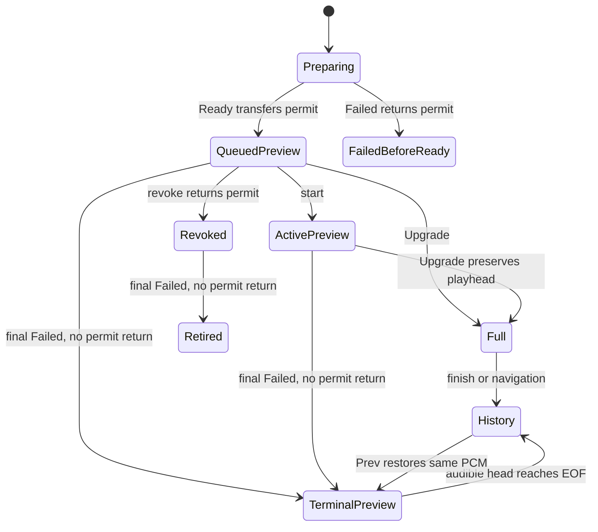

# Engine verification

The driver imports `funkot-core/src/transition_geometry.rs` directly. The engine
and analysis modules call that same source. Kani dependencies stay outside the
release Cargo workspace, Android build and C ABI.

From the core repository root on Linux x86_64 with Docker and cgroup v2:

```sh
./scripts/check-transition-geometry.sh --setup
./scripts/check-transition-geometry.sh
```

The fixed verifier is Kani 0.68.0, bundled Rust nightly-2026-08-21 and CBMC
6.11.0. The runner reuses the player verification entry's 15-minute deadline
and 8-GiB cgroup limit without extra swap. `summary.json` retains elapsed time,
peak memory, revision and source hashes. `kani.json` retains individual checks.
The runner requires a readable Git checkout with a valid HEAD commit and no
tracked or nonignored untracked changes. This applies to clones and linked
worktrees. Use a new or empty evidence directory outside the checkout or in an
ignored directory. A nonempty directory is refused without changing prior results.
It streams `git archive` of that commit into the verifier. Git metadata is not
needed inside Docker, and later checkout edits cannot change the proof source.
An unavailable revision, invalid revision or dirty checkout writes a FAIL summary
and exits before Docker. The validator also rejects missing or malformed revisions.
Timeout, solver failure, missing harnesses and unreached covers fail the command.
Default overflow, assertion, pointer and unwinding checks stay enabled. Neither
function has a loop or recursion, so there is no finite input enumeration or
loop-unwind assumption. The bar proofs quantify independent, unrestricted `u32`
inputs without `kani::assume`. Frame admission quantifies arbitrary `u64`
positions and lengths, plus the simple/full mode.

`plan_all_u32` proves that the compact schedule and fades fit their intro and
outro budgets, that skip plus remaining intro equals the intro, and that the
solo gap remains when the intro can contain it. Zero effective fade is valid
when no fade pair fits. `trigger_all_u32` proves a trigger within the track
body after the intro. For a structural boundary within that body, the trigger
leads it by up to 16 bars, with the full lead whenever room exists. Otherwise
the trigger clips to the intro end. Counts are from the end of the track, so
a larger trigger count means an earlier playback position.

`frame_admission_all_u64` proves that accepted frame ranges fit both decks,
retain the checked previous start and target entry, and retain the requested
endpoints for a full plan. A simple plan clips its fade to common remaining
material. A full plan also requires its target continuation horizon to fit.

The proofs cover integer bar geometry. Floating-point bar-to-frame conversion,
phase correction and deck installation are checked by real engine regressions.
They do not prove phase scores, musical bar identity, real-track sound quality,
click freedom, real-time scheduling, devices, or OS behavior. The 8-bar candidate
question in [#22](https://github.com/yasuyuki/funkot-autodj/issues/22) is separate
and is not an input assumption.

The runner repeats the three sensitivity checks below in isolated temporary
trees within the same total deadline. Each must produce a completed Kani run
with a failing safety assertion. Compilation errors and timeouts do not qualify.
For a manual sensitivity check, copy the production module and driver into an isolated
tree. Replacing `let skip = i.saturating_sub(m)` with `let skip = i` must fail
`plan_all_u32`. Replacing the trigger's `saturating_add(OUTRO_LEAD_BARS)` with
`saturating_add(0)` must fail `trigger_all_u32`. Run the unchanged source again
after discarding the isolated variants. Keep real-code regressions for the
adoption boundary, since integer proofs cannot detect an omitted admission check.
Removing the full-admission previous-material bound must fail both
`frame_admission_all_u64` and the real-engine
`invalid_manual_correction_keeps_decks_queues_and_events_unchanged` regression.

Results and unproved scope are recorded in
[#26](https://github.com/yasuyuki/funkot-autodj/issues/26).

## Manual navigation

`manual_navigation.rs` imports the production `manual_navigation` module.
Kani checks all `u64` generations and frame values, independent identity facts,
optional active decks and plans, and deadlines with or without an available
fallback. It proves current-reply admission, exact-frame adoption, deadline
precedence, and late-plan replan or fallback. Its two harnesses have 3 and 10
reachable covers. They run in the existing geometry job, with its existing
three numeric harnesses and resource limits.

The identity fact comes from the Engine's borrowed `ManualKey` comparisons.
The proof does not establish that a caller constructed that fact correctly.
Real Engine tests replace active and target PCM without a generation change,
replay delayed Restart replies, and reject an old reply after fallback. Each
of the generation, identity, deadline and exact-start mutations must fail both
a completed Kani safety assertion and its named Engine regression. The native
identity variant also disables the Engine's independent identity recheck;
removing only the first predicate leaves that final defense intact. Mutation
edits and regression names share `manual_navigation_mutations.py`.

The separate TLC check enumerates event order. On Linux with Python 3.12 or
later and Java 21, run from the repository root:

```sh
python3 -B verification/check_manual_navigation.py --setup
python3 -B verification/check_manual_navigation.py
```

The setup downloads the fixed TLC 1.7.4 jar and checks its SHA-256. The run
requires a clean committed checkout and a new evidence directory, then checks
a commit archive. `--help` provides explicit Java, jar and evidence locations.
The normal command runs safety, conditional progress and negative variants.
Timeout, missing state counts, a nonempty search queue, an incomplete run or
a negative variant without its specified counterexample fails the command.
The existing 15-minute verification deadline covers the complete run. Java
uses an 8-GiB MaxRAM configuration; this is a JVM sizing input, not a cgroup
process-tree limit. The summary records the Java version, jar hash, source
revision and hashes, state counts, elapsed time and peak child RSS.

### Bounds and assumptions

The model has two accepted-operation identifiers, two source epochs, four
occurrence identities and two PCM identities per occurrence. Four identities distinguish history A, outgoing B, active C and an independent
ready-next D. Three suffice for the actual history counterexample in #44,
but aliasing D to B loses the Next-to-Next distinct-target case. Ready outcomes
cover a fresh occurrence and a repeated current occurrence with different PCM.
Fresh labels are canonical representatives outside the live occurrence set;
other aliases with older history entries are outside this bounded model.
It includes two successive commands, at most two preparation attempts per
accepted operation, and zero, one or two copies of each reply. This covers one
replan and delayed, reordered, lost or duplicate replies. The current worker
normally sends one reply; duplication is a robustness overapproximation.

The clock has three ordered positions within the current active body. A new
adoption resets it. Plan start and the fixed operation deadline remain separate.
This is an order abstraction, not a claim about audio callback duration.
Generations are never reused within the model; `GenerationOrder` checks the
monotone accepted-operation identifier. Integer wraparound is outside TLC.

Preparation is abstracted as an eventual mailbox outcome at dispatch. Arbitrary
poll delay represents a slow worker; zero copies represent loss. Worker failure
prevents further dispatch. The model permits dispatch earlier than a busy real
worker, so it covers additional event orders. It does not equate worker execution
with the Engine's `manual_in_flight` flag. A stale reply poll is an Engine-observable stutter. Its only scheduling effect,
clearing `manual_in_flight`, is already covered by earlier abstract dispatch.
After generation invalidation, the model removes these unobservable old replies.
No dispatch capacity, deadline, invariant or fair Advance/Tick action depends on
their count. The shared Rust predicate proof and stale-reply Engine regressions
justify this boundary. The generation mutation keeps the full stale payload.
No TLC VIEW quotient removes mailbox exits.

Engine changes are serialized. Reply checks and adoption form one indivisible
step. Accept/dispatch and poll/dispatch are split conservatively, admitting
additional mailbox scheduling orders rather than parallel Engine mutations.
A counterexample from that overapproximation requires replay against Rust.

The ordinary config checks safety across the complete bounded event graph.
Progress is checked separately in the stable config, which requires adoption
under fair frame advance and ticking, successful admission, stable identities,
and no superseding command, stop, cancellation, upgrade or source replacement.
Neither result proves progress for an unbounded or permanently stopped system.

### Code correspondence

| Model action | Product operation and observable boundary |
|---|---|
| `SendNav`, `DrainNav` | `drain_nav_commands` and `begin_nav` coalesce normal commands, defer them during a future fence, and preserve duplicate Next's target/deadline. |
| `Dispatch`, `PollReply`, `WorkerFailure` | `kick_manual_plan_if_idle`, the worker channel and `poll_nav_tempo` choose a current reply or discard it. Zero/two copies abstract loss/duplication. |
| `Tick`, `DeadlineFallback` | `tick_decision` and `tick_pending_nav` give an exact reply precedence at its deadline, replan late work without extending the deadline, or make a current simple fallback. |
| `Apply` | `commit_manual_plan` checks identity and `admit_frames` before taking next/history or emitting a start, invalidates rejected work, then `begin_transition_to` installs admitted decks atomically. |
| `Advance` | `render_one_frame` advances the active playhead. DSP and frame lengths are abstracted away. |
| `Cancel`, `Stop` | `cancel_pending_nav` and `stop` invalidate outstanding work. |
| `UpgradeActive`, `UpgradeNext`, `ReadyNext` | `drain_loader` and `apply_upgrade` adopt current loader messages. The future fence prevents those adoptions. |
| `HistoryRollover` | `drop_prev` and `push_history` retain the actual outgoing deck, skip a shared Restart deck, and cancel pending Prev before replacing its target. |
| `FutureBegin`, `FutureAbort`, `FutureCommit` | `begin_future_update`, `abort_future_update` and `commit_future_update` preserve or replace future state and invalidate old navigation. Persistence is outside this model. |

The safety invariants cover generation/source/active/target identity at adoption,
accepted target stability, exact reply start, adoption once, start/consumption
correspondence, and no future adoption while fenced. Admission rejection and
worker failure leave decks and consumption unchanged. The source epoch is
invalidated through navigation generation, as in the product; the model does
not invent a source-epoch field in `ManualKey`.

The deliberate TLC variants remove generation checking, exact-start checking,
deadline fallback, and history-target cancellation. Each must produce its
specified invariant or temporal counterexample. Identity checking is separately
broken in the real shared Rust predicate and Engine regression. In the bounded
protocol model, correct invalidation can make that defensive check redundant.

Read TLC results with `/statechart`. The history trace is the A-to-B-to-C,
accepted-Prev-to-A, history-rollover-to-B sequence replayed by
`history_rollover_cancels_an_accepted_previous_navigation`. The three-line
product correction and its regression are separate commits in PR #44.

Record navigation results in #41. The navigation model does not verify PCM samples, DSP quality,
click freedom, OS scheduling, device output, unbounded request streams or the
preview/full first-live lifecycle, head-only relabeling or arbitrary FIFO
capacity. TLC uses probabilistic fingerprints; its reported collision estimate
is retained with the run logs. Loader identities and future fencing are
represented only at their navigation boundaries. Persistence is covered separately
in player #112; first-live lifecycle is covered below.


## First-live lifecycle

The existing Kani entry also imports `funkot-core/src/first_live.rs` directly.
Its three harnesses quantify independent boolean facts and both `FailedPermit`
variants, with 6, 8 and 2 reachable covers. Upgrade admission requires the same
occurrence, an unfailed non-head preview, and a full incoming buffer. Repeated
full messages cannot replace already adopted PCM or restart its fade. Wait
classification ends a terminal preview at EOF, keeps head-only outside upgrade
wait, and never selects sleeping polling for realtime or scheduled replay.
Stopped/finished engines select no wait. The permit predicate returns a slot
only when no Ready previously transferred it to a preview.

Path/index comparisons, Weak PCM identity, receiver ownership and failure-stage
construction are Engine/loader adapters. Kani does not prove those facts were
constructed correctly. The real Engine regressions check active and queued
adoption, exact PCM/fade identity, FIFO final failure followed by later Ready,
revocation before failure, and preservation of the audible preview tail. Existing
recorded first-live recipe tests rebuild the actual producer buffers and check
PCM/evidence equality. This is distinct from the live Upgrade guard, which does
not authenticate a PCM hash supplied by an adversarial producer.

Run the same pinned TLC entry with the first-live profile:

```sh
python3 -B verification/check_manual_navigation.py --setup
python3 -B verification/check_manual_navigation.py --model first-live
```

The clean commit archive, source attribution, complete-result validation,
15-minute total deadline and Java sizing described above apply to this profile.
Its CI artifact is `first-live-proof`; the existing `transition-proof` artifact
also includes the new Kani harnesses and isolated production mutations.

### Message ownership and terminal preview

`Ready` transfers its preparation permit to the buffer. `Upgrade` uses that
same slot. A final Failed after preview Ready carries a private
`AfterPreview(Weak<PCM>)` payload and never releases another permit. The producer
captures that identity on the loader thread before sending Ready. Failures
before Ready, ordinary full prepares and head-only prepares use `BeforeReady`
and release their untransferred permit. A short first-live file has no preview
Ready and follows that same rule. Revoking the queued preview already returns
its slot, so the later final failure must still release nothing.

The Engine retains the failed preview's Weak identity for its lifetime. It
keeps no PCM payload alive and prevents allocation-address reuse. Moving that
buffer through history, Prev and source replacement preserves its terminal
status. The remaining head stays playable; at EOF the Engine retires it and
continues to a ready future, without waiting for global Exhausted. A late
Upgrade cannot revive that buffer. No new public PreparedTrack/C ABI field,
filesystem operation, lock or sleep is added to the realtime callback.



### Bounds, fairness and correspondence

The model distinguishes two occurrence keys and independent preview/full PCM
identities. Three initial-source preparation attempts exercise normal current/next/history
capacity and the surplus/backpressure case. The replacement has one fresh
occurrence, matching its engine-lifetime index uniqueness contract. Each source
then polls exhaustion; this does not cover longer replacement queues. Initial-source attempts may reuse their
path/index as a looping PlaylistSource does; the replacement uses a fresh key.
Attempt numbers are allocation/permit evidence only, never production guards.
One optional source replacement explores old/new receiver isolation without
integer generation wraparound. Replacement workers prepare full/head buffers
and cannot create another non-head first-live preview.

Head-only retains the real 12-head prefetch allowance and its resulting permit
capacity. The bounded inputs do not enumerate a completely filled head queue.
The frame abstraction has preview/head length one and full length two; native
replay tests cover actual frame and PCM adapters. This does not prove arbitrary
buffer lengths, audio content, allocation behavior or throughput.

`FirstLive.cfg` checks safety across legal capacity-one FIFO producer order.
`FirstLiveRobust.cfg` separately injects one extra Upgrade, choosing a duplicate
full, wrong-index full, wrong-path full, preview or head-only payload, including
arrival before Ready or after failure/adoption. Those are
robustness inputs, not messages emitted by the current producer. It does not
assume that arbitrary lost or reordered messages retain progress.
`FirstLiveStable.cfg` checks resolution and finite non-head source completion
under weakly fair producer, current-receiver drain and render actions, with no
superseding navigation, revoke, stop, fence or source replacement. Offline poll
owns `&mut Engine`; a hypothetical concurrent `stop()` is not its escape path.
Stop is checked as a terminal safety boundary before later render/control.
Normal stop/finite completion and the actual preview silence/poll boundary have
explicit stutter actions. TLC deadlock checking stays enabled elsewhere.

| Model action | Product boundary and native evidence |
|---|---|
| `Acquire`, `SendPrepared`, `SendFinal` | `loader_main_mode`, `wait_permit`, `prepare_first_live` and `send_msg`: one acquired slot, Ready success, then Upgrade or stage-tagged Failed. |
| `Consume` Ready / `Revoke` | `drain_loader`, `take_next`, `revoke_next`: queued buffer ownership and one return on revocation. |
| `Consume` Failed | Failure-stage permit decision and Weak terminal identity; final failure must not return a transferred slot. |
| `ApplyUpgrade` | `upgrade_allowed`, `apply_upgrade`, `apply_queued_first_live_upgrade`: occurrence, stage and terminal guards before any PCM/fade mutation. |
| `Render` | `preview_wait`, `await_preview_upgrade`, `tick_head_only`, `render_one_frame`: realtime yield, offline poll, terminal EOF and natural advance. |
| `JumpForward`, `JumpPrevious` | Accepted navigation ownership projection through next/history. Planner timing and transition DSP stay in their existing checks. |
| `BeginFuture`, `AbortFuture`, `CommitFuture` | Existing future fence and receiver/pool replacement. Retained terminal history belongs to its buffer, not the new receiver. |
| `Stop`, `Resume` | Terminal stop versus resumable natural finish. |

The transferred-permit invariant compares actual credit values before and after
final failure, including a revoked preview; it is not global permit conservation.
Head-only mode is fixed per run. The isolated model variants break receiver
selection, transferred-permit ownership, terminal identity retention, failed-preview EOF resolution, Upgrade
stage and occurrence checks. Each must produce its named safety or temporal
counterexample. Production mutations in `first_live_mutations.py` must fail
completed Kani assertions and the named Engine tests where an observable native
adapter is provided. Stop/realtime decision mutations are checked directly by
Kani; the render entry has additional independent stop guards. The receiver
variant is native-only because receiver exchange is not a pure function. The
producer-stage variant must fail the synthetic preparation adapter, which checks
actual Ready/Failed order and the Weak payload.
Transport-assumption diagnostics separately inject duplicate Ready, duplicate
BeforeReady Failed and premature Exhausted. Their counterexamples describe
unsupported channel inputs, not product traces: the real worker has one sender
and a reliable FIFO. They must remain distinct from the passing legal model and
Upgrade robustness check.
Compilation errors, zero selected tests, solver/tool failures and timeouts are
not accepted counterexamples.

Record results in #42. The model projects accepted hard jumps rather than the
full planner, concurrent transition decks or shared Restart aliases. Scheduled
recorded replay is covered by native tests, not this loader model. It does not
prove sound quality, click freedom, OS/device timing, progress with permanent
worker loss, unlimited inputs/replacements, arbitrary head-queue occupancy or
PCM authenticity. TLC fingerprint collision estimates remain in its logs.
